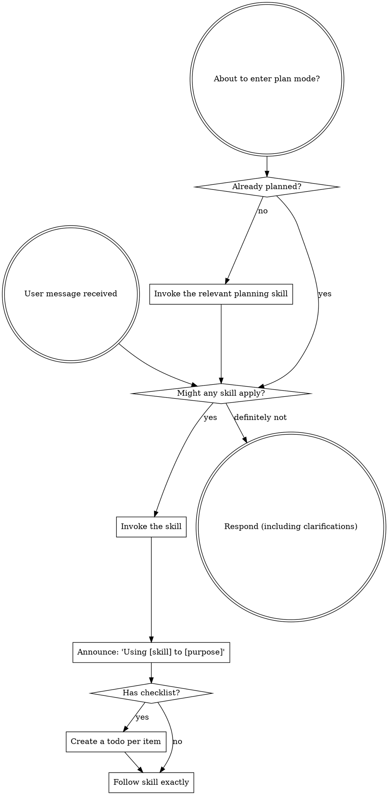

<SUBAGENT-STOP>
If a parent agent started you as a subagent for a task, skip this skill.
</SUBAGENT-STOP>

<EXTREMELY-IMPORTANT>
If a skill applies to the task, invoke it.
</EXTREMELY-IMPORTANT>

## Instruction Priority

Use the first applicable instruction in this sequence:

1. **User's explicit instructions** in `AGENTS.md` and in user messages.
2. **Coderails skills** where they give instructions different from default system behavior.
3. **Default system prompt**.

If `AGENTS.md` says "don't use TDD" and a skill says "always use TDD," follow the user's instructions. The user is in control.

## How to Access Skills

**Do not read skill files manually with file tools.** Use your platform's skill-loading mechanism to activate the skill.

**In Codex:** Skills load natively. Follow the instructions Codex gives when the skill activates.

## Platform Adaptation

Skills tell you how to start agents, track tasks, and read files.
Use [codex-tools.md](references/codex-tools.md) to find the Codex tools.

# Using Skills

## The Rule

Invoke each applicable skill or skill the user names before you answer or do work.
If it does not apply after invocation, stop using it.

## Red Flags

If you have one of these thoughts, stop:

| Thought | Reality |
|---------|---------|
| "This is just a simple question" | Check for a skill before you answer. |
| "I need more context first" | Skill check comes BEFORE clarifying questions. |
| "Let me explore the codebase first" | Skills tell you HOW to explore. Check first. |
| "I can check git/files quickly" | Check for skills before you read. |
| "Let me gather information first" | Skills tell you HOW to collect information. |
| "This doesn't need a formal skill" | If a skill exists, use it. |
| "I remember this skill" | Skills evolve. Read current version. |
| "This doesn't count as a task" | Work is a task. Check for skills. |
| "The skill is overkill" | Simple things become complex. Use it. |
| "I'll just do this one thing first" | Check BEFORE doing anything. |
| "This feels productive" | Work without a plan wastes time. Skills prevent this. |
| "I know what that means" | Knowing the concept ≠ using the skill. Invoke it. |

## Skill Priority

When multiple skills could apply, use this sequence:

1. **Procedure skills first.** Examples are `$coderails-codex:planning-sequence`,
   `$coderails-codex:task-evals`, and `$coderails-codex:cite-check`. These guide how you start the task.
2. **Implementation skills second.** Examples are frontend-design and
   mcp-builder. These guide execution.

If the user tells you to build something, run planning and task evals before implementation guidance.
If the user tells you to check a claim, use cite-check before a skill for that topic.

## Skill Types

**Rigid** (task-evals, cite-check): Follow all instructions. Keep the requirements for checks and sources.

**Flexible** (patterns): Adapt principles to context.

The skill itself tells you which.

## User Instructions

When the user gives a task, the applicable workflow stays in effect.
