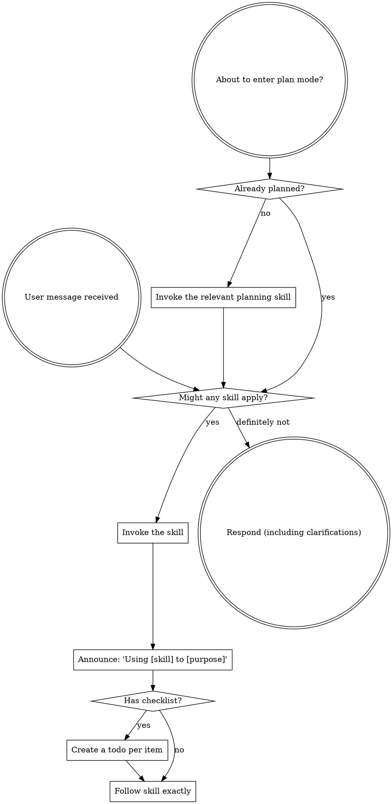

<SUBAGENT-STOP>
If you were dispatched as a subagent to execute a specific task, skip this skill.
</SUBAGENT-STOP>

<EXTREMELY-IMPORTANT>
If a skill applies to the task, invoke it.
</EXTREMELY-IMPORTANT>

## Instruction Priority

coderails skills override default system prompt behavior, but **user instructions always take precedence**:

1. **User's explicit instructions** (`AGENTS.md` and direct requests) — highest priority
2. **coderails skills** — override default system behavior where they conflict
3. **Default system prompt** — lowest priority

If `AGENTS.md` says "don't use TDD" and a skill says "always use TDD," follow the user's instructions. The user is in control.

## How to Access Skills

**Never read skill files manually with file tools** — always use your platform's skill-loading mechanism so the skill is properly activated.

**In Codex:** Skills load natively. Follow the instructions presented when a skill activates.

## Platform Adaptation

Skills describe actions such as dispatch, task tracking, and file reads.
Use [codex-tools.md](references/codex-tools.md) to find the Codex tools.

# Using Skills

## The Rule

Invoke a relevant or requested skill before a response or action. If it does
not apply after invocation, stop using it.

## Red Flags

These thoughts mean STOP—you're rationalizing:

| Thought | Reality |
|---------|---------|
| "This is just a simple question" | Check for a skill before you answer. |
| "I need more context first" | Skill check comes BEFORE clarifying questions. |
| "Let me explore the codebase first" | Skills tell you HOW to explore. Check first. |
| "I can check git/files quickly" | Check for skills before you read. |
| "Let me gather information first" | Skills tell you HOW to gather information. |
| "This doesn't need a formal skill" | If a skill exists, use it. |
| "I remember this skill" | Skills evolve. Read current version. |
| "This doesn't count as a task" | Action = task. Check for skills. |
| "The skill is overkill" | Simple things become complex. Use it. |
| "I'll just do this one thing first" | Check BEFORE doing anything. |
| "This feels productive" | Undisciplined action wastes time. Skills prevent this. |
| "I know what that means" | Knowing the concept ≠ using the skill. Invoke it. |

## Skill Priority

When multiple skills could apply, use this order:

1. **Process skills first.** Examples are `$coderails-codex:planning-sequence`,
   `$coderails-codex:task-evals`, and `$coderails-codex:cite-check`. These
   determine how to approach the task.
2. **Implementation skills second.** Examples are frontend-design and
   mcp-builder. These guide execution.

For a build request, run planning and task evals before implementation guidance.
For a request to verify a claim, use cite-check before a domain-specific skill.

## Skill Types

**Rigid** (task-evals, cite-check): Follow exactly. Don't adapt away their evidence discipline.

**Flexible** (patterns): Adapt principles to context.

The skill itself tells you which.

## User Instructions

A task request does not cancel an applicable workflow.
