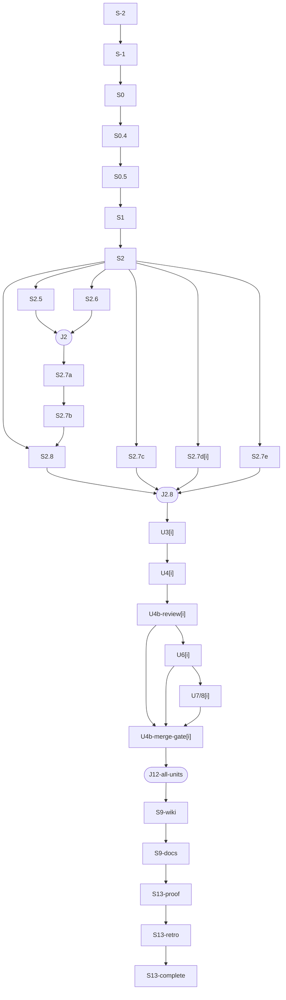

# Execution graph — stable contract

Detail-carrier for [SKILL.md](SKILL.md)'s "The phases" section. This is a contract spec, not a
phase-by-phase instruction — consult it whenever you need a node's exact prerequisites, readiness
predicate, or skip condition; the phase prose in SKILL.md covers what to *do*, this file covers
what makes a node *ready*.

Before dispatching any candidate node, run the read-only readiness query
`python3 "${PLUGIN_ROOT}/hooks/scripts/lib/graph_readiness.py" <path-to-progress.json> <node-id>`,
where `PLUGIN_ROOT` resolves as follows. Prefer `${CLAUDE_PLUGIN_ROOT}` when
it is set in your shell — it is substituted in command frontmatter and in
`hooks.json`'s own hook command strings, for both a directory-marketplace and
a packaged install, but it is normally unset in an orchestrator-issued Bash
call, since it is not substituted into your own Bash tool calls. Before
dispatching against whatever it resolves to, confirm the script actually
exists at that path (e.g. `[ -f "$PLUGIN_ROOT/hooks/scripts/lib/graph_readiness.py" ]`)
— a packaged install's cache copy can predate this script's introduction. The
script prints JSON `{"ready": bool, "reason_code": ...}`; a missing script, or
output that is not that JSON, is a resolution failure and is distinct from a
typed not-ready verdict. This script is an orchestrator preflight and is advisory by
design: the enforcing check is `begin-wave`, which opens only core-ready nodes
whatever this script says. If the file is
missing, stop and report that PLUGIN_ROOT resolved to a directory without this
script — do not dispatch. When `${CLAUDE_PLUGIN_ROOT}` is unset, do not
construct or guess a path — reuse the plugin root you already have from this
session's own rendered context instead: the currently-loaded skill's own
"Base directory for this skill:" line, or a plugin-root path already
substituted into other rendered skill/template text this session (e.g. a
`source` command from a `/coderails:*` slash command). Never `git rev-parse
--show-toplevel` of the invoking repo — that's the *user's* project, not the
plugin's location. Do not hand-construct a versioned plugin cache path (e.g.
guessing a version under `~/.claude/plugins/cache/`) — if `${CLAUDE_PLUGIN_ROOT}`
itself resolves to a cache copy, that's the harness's answer and the
file-existence check above is what catches a stale one, not a blanket ban on
the directory. If neither `${CLAUDE_PLUGIN_ROOT}` nor a plugin-root path is
available anywhere in this session's rendered context, stop — report that the
plugin root is unresolvable and do not dispatch the node.
Dispatch only nodes it reports `"ready": true` for (exit 0 iff ready). Its
`reason_code` is exactly one of `ready`, `predecessor_pending` (a real
non-terminal predecessor), `node_unknown` (the node is not in the graph),
`node_not_pending` (already running or terminal), `graph_blocked` (an active wave or hard stop),
`join_not_dispatchable` (joins release automatically), or
`state_unreadable` (missing or malformed `progress.json`); treat each non-ready
code as a different next step, never as one undifferentiated "blocked". Conversely, a node with no recorded incoming edges is vacuously
`ready` — register the candidate's node and edges before querying, not after.
Run ready independent nodes in one wave, but preserve every listed dependency.
The orchestrator is the only writer of `progress.json`: collect a wave's results, then do one
read-modify-write before releasing its join. Inside an authorised loop, the
`U*` lane below repeats per work-unit.

**Resolving and recording a wave — the native Python CLI.** Use
`python3 "${PLUGIN_ROOT}/skills/agentic-loop/scripts/graph.py"` with the same
verified plugin-root resolution above. The CLI uses the provider's own lock,
transcript parser and independently installed pure graph semantics.

1. Run `plan <path-to-progress.json>` before dispatch. It returns a JSON array
   of instruction sources. A source with `unresolved:true` must be resolved
   before executing that node. Joins are automatic and are never Agent calls.
   Instruction sources, roles and `skip_when_met` come from the machine-readable
   spec (`packages/graph-semantics/graph-spec.yaml`, thresholds in `policy.yaml`):
   a node whose `skip_when_met` is `true` (for example `S2.7a` below the
   `design_doc_min_units` threshold) is recorded as skipped, not dispatched. Every
   load refuses a graph that omits an edge the spec requires between two nodes it
   holds (`spec_edge_missing`). `graph.py instantiate <state> --session <s> --loop-id <l>
   [--profile units-only|full] [--unit <n>]...` builds the spec's graph into an
   empty started loop and stamps `graph.spec_sha256`; a stamped graph also
   rejects unknown nodes, missing spec nodes and a changed spec.
2. Run `begin-wave <path-to-progress.json>` immediately before dispatch. It
   records exactly the ready nodes as running, captures the native transcript
   cursor, and returns the current `wave_id` and each dispatch's `prompt_prefix`.
   A failure means no dispatch is authorized.
3. Use the returned prefix as the exact first prompt line, then a newline and
   the explicit instruction body from the resolved source plus the task brief.
   User restrictions take precedence. Use Claude's available native
   `subagent_type`, normally `general-purpose`, or a custom type actually installed
   in this session. Graph IDs and instruction sources do not rename provider
   workers or require `coderails:loop-worker`. The envelope is
   `CODERAILS_GRAPH_DISPATCH={"session_id":"<session>","loop_id":"<loop>","revision":4,"wave_id":"wave-4","node_id":"U3[1]"}`.
   `loop_dispatch_guard.py` checks exact current session, loop, revision, wave
   and node ownership. Its resolution path is a successful `begin-wave` and
   the returned prefix, never hand-edited ownership or a renamed worker.
4. Collect every node's result before recording. Run
   `record-wave <path-to-progress.json> '{"wave_id":"<wave>","results":{"<node>":{"outcome":"done","evidence":"<artifact result>"}}}'`
   with exactly the active node set. Evidence supplied by the caller is prose;
   do not insert native identities, including nested or serialized copies.
   The adapter derives them from actual parent Agent requests/results, child
   transcripts, role attribution and harness terminal notifications. Every
   child in a fan-out must qualify. Worker claims and echoed notification text
   cannot establish completion.
5. The sole locked read/validate/write applies the whole wave, retry bounds and
   every newly satisfied all-input join. Partial, extra, stale or foreign results
   leave state unchanged. Never edit joins or increment retry counts yourself.

**Eval ownership differs from dispatch ownership.** Frozen dispatch evals bind
`session_id` + `loop_id` only. Their frozen revision can precede the active graph
revision: beginning a wave must not invalidate the suite. The dispatch envelope
still binds the exact current revision, wave and node. Nonempty `work_units`
requires valid frozen loop evals before implementation. Completion requires the
final revision's neutral grading and identity-bound completion artifacts.

**Failure and replacement.** A `failed` wave result increments the bounded
retry counter. In a FULL graph, `U4`, `U4b-review`, and `U4b-merge-gate` become
blocked until `record-repair <state> --session <session> --unit <unit>
--failed-node <node> --kind source|artifact|check --identity <distinct-id>
--diagnosis <reason>` records a diagnosed repair. That transition requeues `U4`
and downstream verification. Other nodes return to pending; every node
hard-stops at its retry limit.
A `stale` result also requires `stale_check: {"checked":true,"method":"<artifact check>","result":"<observation>"}`
in that same result. Idle alone is insufficient. After checking the actual
artifact, run `respawn-stale <state> --session <session> --node <node> --reason <reason>`
for a new generation; preserve all prior native evidence. The provider supplies
fresh worker identity on the next dispatch. A fake generation or reused child
cannot satisfy completion.

**Sequential tail and joins.** `S9-wiki -> S9-docs` remains a plain dependency:
record the wiki outcome before a new plan can dispatch docs. `J12-all-units`
is never dispatched; recording its final successful input releases it in the
same locked write. Every unit's merge-gate node must remain an explicit input.

Node IDs are stable documentation identifiers. `S*` nodes run once; `U<i>*`
nodes run once per work-unit `i`; `J*` nodes are explicit joins. A skipped node
is still recorded as `skipped: <predicate>` in loop state; it is not a failed
node and cannot satisfy a prerequisite by omission.

<!-- BEGIN GENERATED graph-spec:diagram -->

<!-- END GENERATED graph-spec:diagram -->

The diagram and the table below are generated from
`packages/graph-semantics/graph-spec.yaml` and `policy.yaml` by
`python3 scripts/gen_graph_docs.py` (`--check` fails the test run on drift);
edit the spec, never the generated regions. The diagram is a shape guide; the
table is authoritative where a line would be ambiguous.

<!-- BEGIN GENERATED graph-spec:table -->
| ID | Kind | Node / true prerequisites | Ready when | Conditional skip or join |
|---|---|---|---|---|
| `S-2` | `node` | Start state (`graph.py start`) | path helper returns the session-owned state path | never skipped |
| `S-1` | `node` | Improve prompt | prompt is adopted, revised, or explicit opt-out is recorded | full-autonomous auto-adopts; otherwise one bounded input point |
| `S0` | `node` | Read envelope | envelope class and stop conditions are recorded | never skipped |
| `S0.4` | `node` | Model-cost notice | notice emitted | never a gate; no model switch is performed by the orchestrator |
| `S0.5` | `node` | Operating rules | confidence, verification, and `LOOP-STOP` rules are active | never skipped |
| `S1` | `node` | Plan | work-unit list, dependencies, and success criteria exist | Phase 1 confirmation may be `awaiting-input` |
| `S2` | `node` | Plan | pre-flight agent result, wiki/theme intake, retro lessons, and clean-base check exist | never spawn implementation before this node |
| `S2.5` | `node` | `S2` | design scout returned a recommendation and flip-condition | skip when no unresolved design fork |
| `S2.6` | `node` | `S2` | disposition scout returned a result for every retirement unit | skip when no named existing path is retired |
| `J2` | `join` | `S2.5` and `S2.6` | all triggered scouts returned; orchestrator validated and absorbed both results in one state write | skipped branches contribute an explicit skip record |
| `S2.7a` | `node` | `J2` | durable `spec.md` exists | only if `work_units >= 3` or a cross-unit dependency exists |
| `S2.7b` | `node` | `S2.7a` | durable `plan.md` exists and matches the work-unit list | same predicate as `S2.7a`; `S2.7b` is sequential after it |
| `S2.7c` | `node` | `S2` plus authorising prompt | loop-scope evals are frozen before build | required for any `work_units >= 1` loop or an irreversible-surface trigger; NOT gated by `S2.7a`'s ≥3-work-unit threshold |
| `S2.7d[i]` | `node` | `S2` plus each unit definition | PR-scope evals are frozen before that unit builds | skip only for a unit with no PR; required before its merge gate |
| `S2.7e` | `node` | `S2` plus executable-surface decision | blind `proof.json` exists, or explicit no-executable disposition is recorded | required for every executable loop; independent of `S2.7a/b` |
| `S2.8` | `node` | `S2` and `S2.7b` when triggered | every build unit has one recorded model role | may run beside independent evidence branches; never releases a unit without its required inputs |
| `J2.8` | `join` | `S2.8`, plus `S2.7d[i]`/`S2.7e` where required | all inputs for the first eligible unit are present | later units wait on their own true prerequisites |
| `U3[i]` | `node` | `J2.8`, unit dependencies, and required eval/proof inputs | worker produced the unit's committed artifact/OPEN PR terminal state | units with `blockedBy` dependencies wait; independent units may run in waves |
| `U4[i]` | `node` | `U3[i]` | artifact, worktree, PR, and worker report were checked by the orchestrator (a `NEEDS_DECISION`/`OUTSIDE_SCOPE`/`IRREVERSIBLE_ACTION` report is validated with `skills/agentic-loop/scripts/worker_status.py` and surfaced by the orchestrator only; not a `record-wave` outcome) | idle is not failure; failed artifact check enters repair |
| `U4b-review[i]` | `node` | `U4[i]` | required review Skill, security/deploy review when triggered, and SHA-bound post-review artifact exist | review findings go to `U5[i]`; no merge on a missing artifact |
| `U5[i]` | `guard` | `U4b-review[i]` | source-of-truth premise is confirmed and diagnosis is disconfirmed | premise disproven is a hard-stop; otherwise spawn the repair worker |
| `U5-repair[i]` | `guard` | `U5[i]` | distinct fix attempt applied and locally verified | back to `U4[i]`; at most 5 distinct attempts per failure |
| `U6[i]` | `node` | current unit is verified and any in-scope confirmation decision is resolved | envelope permits autonomous continuation or required approval is granted | no extra ask inside the envelope |
| `U7/8[i]` | `node` | `U6[i]` | stack-specific push/deploy tactic completed, if applicable | skip when no push/deploy surface; these phases do not add generic policy |
| `U4b-merge-gate[i]` | `node` | `U4b-review[i]`, `U6[i]`, `U7/8[i]`, PR-scope eval, review artifact, and integrity attestation | exact-head review/eval/integrity checks and gate-time smoke pass; merge reports `MERGED` | any missing/stale/failing gate enters `U5-repair[i]` or hard-stop after retry bound |
| `U10-respawn[i]` | `guard` | `U4[i]` artifact check shows dispatch failure/idle without artifact | new versioned worker name and fresh dispatch exist | not triggered by an idle ping alone; returns to `U4[i]` |
| `J12-all-units` | `join` | every unit's merge gate passed | each merged PR and dependent deployment evidence is freshly rechecked | no unit may be silently omitted |
| `G10` | `guard` | any respawn path | every replacement worker name is versioned | cross-cutting Phase 10 guard; no standalone work |
| `G11` | `guard` | every worker dispatch and report | prompts and reports carry confidence labels | cross-cutting Phase 11 guard; no standalone work |
| `G12` | `guard` | every artifact boundary | the orchestrator freshly rechecks the artifact before releasing a dependent node | cross-cutting Phase 12 guard; `J12-all-units` is its final aggregate join |
| `S9-wiki` | `node` | `J12-all-units` | clustered wiki ingest and lint landed and were verified on `origin/main` | skip only when no wiki update is in scope; still record the skip |
| `S9-docs` | `node` | `S9-wiki` | one `/sync-docs` audit completed and findings triaged | pre-existing drift is reported, not folded into scope |
| `S13-proof` | `node` | `S9-docs` | every frozen proof command ran verbatim in the orchestrator session and passed | absent proof requires the recorded no-executable disposition |
| `S13-retro` | `node` | `S13-proof` | Phase 13 report, cost, decisions, artifacts, eval result, standing orders, and feedback are written | never a mid-loop checkpoint |
| `S13-complete` | `node` | `S13-retro` | final aggregate verification passes; `progress.json` is complete and `retro.json` is valid | terminal node; emits `LOOP-STOP: complete` |
<!-- END GENERATED graph-spec:table -->

Rows marked `guard` describe conditional procedures; `instantiate` does not create dispatchable graph nodes for them.
An ordinary failed wave result retries its node up to its bound. A stale worker with a completed artifact check uses
`respawn-stale` on that worker node. Review findings require repair and a fresh review before the review node can be
recorded done; an unresolved finding cannot release its dependent merge gate.
`S0.5`, `U4`, `U4b-review`, `U6`, and `S13-complete` carry the Phase 11/12
confidence-label and fresh-evidence rules; they are guards on the nodes above,
not extra work. A review finding, failing eval, smoke failure, or verification
failure follows the conditional `U5 -> U5-repair -> U4` procedure. The diagnosed
repair is recorded with `record-repair` and a distinct source SHA, artifact ID,
or check ID. The machine refuses a duplicate identity and enforces the policy's
repair bound. The node also hard-stops after five recorded failures. Independent
failure domains may use parallel repair workers, each with its own bound, then
join at `U4`.
