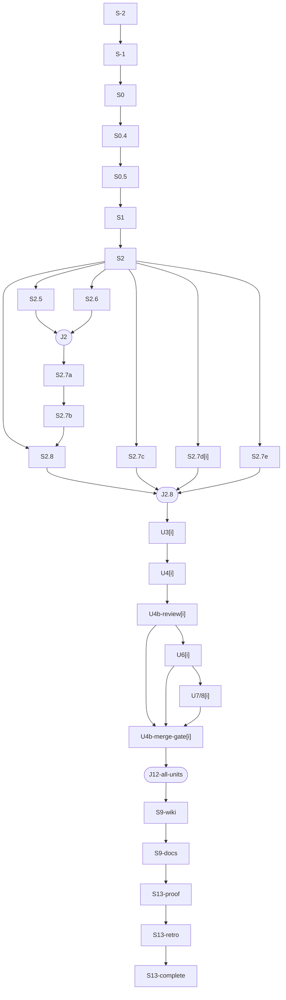

# Execution graph — stable contract

Use this file with "The phases" in [SKILL.md](SKILL.md).
It gives each node’s prerequisites, readiness predicate, and skip condition.
For the steps to do, use the phase instructions in SKILL.md.

Before starting a candidate node, run the read-only query
`python3 "${PLUGIN_ROOT}/hooks/scripts/lib/graph_readiness.py" <path-to-progress.json> <node-id>`.

If `${CLAUDE_PLUGIN_ROOT}` is set in the shell, use it as `PLUGIN_ROOT`.
The harness fills it in for command frontmatter and commands in `hooks.json`, for a directory marketplace or a packaged install.
The harness usually does not set it in the orchestrator’s Bash calls.

Check that the script is available with `[ -f "$PLUGIN_ROOT/hooks/scripts/lib/graph_readiness.py" ]`.
A packaged install can have a cache copy from before this script.
The query prints `{"ready": bool, "reason_code": ...}`.
If you have no script or the output has a different shape, report a path or query problem and stop.
Report that result as a query problem. Use a typed not-ready verdict only if the JSON has the specified shape.

The query gives advice. The `begin-wave` check opens only core-ready nodes.

If `${CLAUDE_PLUGIN_ROOT}` is unset, use a plugin-root path from this session’s rendered context.
For example, read "Base directory for this skill:" or a rendered `source` command from a `/coderails:*` slash command.
Do not use `git rev-parse --show-toplevel` on the user’s project to find the plugin.
Do not guess a version path in `~/.claude/plugins/cache/`.
If the harness gives a cache path, use the file check above to check that copy.
If no plugin path is available, report it and do not start the node.

Start only nodes with `"ready": true`. Exit 0 means `ready`.
The `reason_code` can be one of these values:

- `ready`: The query allows the node to start.
- `predecessor_pending`: A predecessor is not terminal.
- `node_unknown`: The graph does not have this node.
- `node_not_pending`: The node is `running` or terminal.
- `graph_blocked`: An active wave or hard stop blocks the graph.
- `join_not_dispatchable`: The graph releases joins automatically.
- `state_unreadable`: There is no `progress.json`, or its format is incorrect.

Use the next step for the code you get. Do not report all results as "blocked".
A node without recorded incoming edges gives `ready`.
Add the candidate node and its edges before the query.
Run nodes with `ready` in one wave if they have no dependencies on each other.
Keep all listed dependencies.

The orchestrator is the only writer of `progress.json`.
Collect the wave results, then do one read, change, and write before the join releases.
In a loop with user authorization, use the `U*` lane for each work unit.

**Use the native Python CLI for waves.**
Use `python3 "${PLUGIN_ROOT}/skills/agentic-loop/scripts/graph.py"` with the plugin-root rules above.
The CLI uses the provider’s own lock, transcript parser, and install of the pure graph semantics.

1. Run `plan <path-to-progress.json>` before starting nodes. It gives a JSON array of instruction sources. If a source has `unresolved:true`, resolve it first. The graph releases joins automatically without Agent calls.

   The spec `packages/graph-semantics/graph-spec.yaml` supplies instruction sources, roles, and `skip_when_met`. Thresholds are in `policy.yaml`. If a node’s `skip_when_met` is `true`, record a skip and do not start it. For example, skip `S2.7a` below `design_doc_min_units`. Each load checks for a spec edge between nodes in the graph. A missing edge gives `spec_edge_missing`.

   Run `graph.py instantiate <state> --session <s> --loop-id <l> [--profile units-only|full] [--unit <n>]...` to build the spec graph in an empty started loop. It records `graph.spec_sha256`. A graph with that stamp also refuses unknown nodes, missing spec nodes, and a changed spec.

2. Run `begin-wave <path-to-progress.json>` immediately before starting workers. It sets `running` only for nodes that satisfy the readiness predicate and captures the native transcript cursor. It writes one single-use record for each node in `graph.dispatches`.

   The closed contract has these fields: `role`, `model_role`, `base_ref`, `worktree`, `manifest`, `source_manifest_sha256`, and `source_head_sha`. It also has `publication_command`, `disposition`, `lessons`, `lessons_sha256`, `write_scope`, `skip_phases`, `scope`, and `required_context`.

   The command gives each `dispatch_id`, `prompt_prefix`, and `prompt_sections`. If the command fails, do not start the worker. If `state_minor` is below 3, run `graph.py convert` first. It refuses if a wave is open.

3. Copy `prompt_prefix` verbatim onto the first prompt line. Then copy `prompt_sections`, the resolved source’s instruction body, and the task brief. Follow the user’s restrictions first. The envelope is `CODERAILS_GRAPH_DISPATCH={"dispatch_id":"disp_...","envelope_version":2,"loop_id":"<loop>","node_id":"U3[1]","revision":4,"session_id":"<session>","wave_id":"wave-4"}`.

   The `loop_dispatch_guard.py` hook looks up the ID in `graph.dispatches`. It compares each ownership field with the record and graph data. It calculates the sections digest from the saved contract. It checks for the verbatim rendered sections in the prompt. It consumes the ID and refuses a second use with `dispatch_replayed`.

   Use `subagent_type: coderails:<role>` for the node’s contract role. The read-only scout roles in `guarded_agents` accept only that type: preflight-scout, design-scout, disposition-scout, source-auditor, and deploy-safety-reviewer. Other roles also accept `general-purpose`. Other values give `role_mismatch`. If refused, copy the correct fields from `begin-wave`. Do not edit ownership or change the role by hand.

   The unit’s `publication_command` names the unit and resolved `progress.json`. The guard compares the command with the active path. For the first push of a stacked branch, use `add-unit --base-branch <parent>`. Subsequent pushes use the live PR base. Before transport, the push script checks the flags, registered manifest, two paths in a PR rename, and recorded worktree.

   Use `add-unit --manifest <glob> --worktree <absolute-checkout>` for a new source manifest. The checkout must be a clean Git root with a committed HEAD. Registration saves the manifest binding. The dispatch record binds its contract to the current HEAD. The `assign-worktree` command applies the same checks to a pending unit.

   The native and driver adapters run `lessons.py --dir <repo-key-dir> --session <owner> query --format contract` before they lock `progress.json`. They put the typed rows and digest in the contract and check the snapshot again before authorization. If there is no result or the result is refused or stale, the adapters refuse to start a worker. With explicit `memory.backend: off`, they keep eligible local ledger rows. That result is empty only if no active record qualifies.

   Historical v2 records keep their initial rendered sections and digest. The plugin agent must be installed in this session for a guarded scout. The sandboxed Bash launcher has no agent type (handoff H3).

4. Collect all results before recording. Run `record-wave <path-to-progress.json> '{"wave_id":"<wave>","results":{"<node>":{"outcome":"done","evidence":"<artifact result>"}}}'` with the active node set only. Use prose for the caller’s `evidence`. Do not add native IDs to the result, its nested data, or its serialized data.

   The adapter gets IDs from the parent Agent calls and results, child transcripts, role attribution, and harness terminal notifications. Each child in a fan-out must qualify. A worker claim or echoed notification cannot show that the work ended.

   If there is no design fork, record `S2.5` as `skipped` with `no_design_fork: <reason>`. If no path retires, use `no_retired_path: <reason>` for `S2.6`. Each record gets a typed skip citation for this wave. It cannot replace a prior scout try.

   For a `non_independent` fallback, use the prior refused scout call. Send the user an explicit approval question that names the loop and retry. The next direct user reply must be `approve`. The native approval check refuses a missing, changed, or unrelated reply.

5. One locked read, validation, and write applies the full wave, retry limits, and newly satisfied all-input joins. The graph data does not change for a missing, unexpected, stale, or mismatched result. Do not edit joins or increase retry counts by hand.

**Eval and dispatch ownership.**
Frozen dispatch evals bind only `session_id` and `loop_id`.
Their frozen revision can be earlier than the active graph revision.
The start of a wave does not invalidate the suite.
The dispatch envelope binds the active revision, wave, and node.

If `work_units` is nonempty, use frozen loop evals that pass validation before implementation.
To complete the graph, use neutral grading for the last revision and artifacts bound to the graph identity.

**Retry and replacement.**
A `failed` wave result increases the bounded retry counter.
In a FULL graph, `U4`, `U4b-review`, and `U4b-merge-gate` become blocked.

To record the repair, use `record-repair <state> --session <session> --unit <unit> --failed-node <node> --kind source|artifact|check --identity <distinct-id> --diagnosis <reason>`.
This requeues `U4` and its dependent verification nodes.
Other nodes go to pending. Each node hard-stops at its retry limit.

For a `stale` result, include `stale_check: {"checked":true,"method":"<artifact check>","result":"<observation>"}` in the same result.
An idle notice alone does not satisfy this check.
After you check the artifact, run `respawn-stale <state> --session <session> --node <node> --reason <reason>` for a new generation.
Keep the previous native records.
The provider gives the new worker identity when it starts.
A fake generation or reused child cannot complete the graph.

**Wiki, docs, and joins.**
For `S9-wiki -> S9-docs`, record the wiki result before a new plan can start docs.
Do not start a worker for `J12-all-units`.
The graph releases that join in the same locked write that records its last satisfactory input.
Keep each unit’s merge-gate node as an explicit input.

The node IDs are stable.
An `S*` node runs one time. A `U<i>*` node runs for work unit `i`. A `J*` node is a join.

Record a skipped node as `skipped: <predicate>` in the graph data.
The record satisfies the prerequisite as a skip. Include that record.

<!-- START GENERATED graph-spec:diagram -->

<!-- END GENERATED graph-spec:diagram -->

The command `python3 scripts/gen_graph_docs.py` makes the diagram and table from `packages/graph-semantics/graph-spec.yaml` and `policy.yaml`.
The `--check` option fails the test if they are different from those sources.
Edit the spec to change them.
Use the diagram to see the graph shape and the table for each dependency.

<!-- START GENERATED graph-spec:table -->
| ID | Type | Node / prerequisites | Conditions to satisfy | Conditional skip or join |
|---|---|---|---|---|
| `S-2` | `node` | Start the loop with `graph.py start`. | The path helper gives the session its loop path. | Do not skip. |
| `S-1` | `node` | Revise the prompt. | The workflow records the prompt selection. Accept the proposed prompt, revise it, or record an opt-out. | Full autonomy accepts the proposed prompt automatically. In other modes, get user input at one step. |
| `S0` | `node` | Read envelope | envelope class and stop conditions are recorded | Do not skip. |
| `S0.4` | `node` | Model-cost notice | notice emitted | This notice does not block the workflow. The orchestrator does not change the model. |
| `S0.5` | `node` | Operating rules | confidence, verification, and `LOOP-STOP` rules are active | Do not skip. |
| `S1` | `node` | Plan | work-unit list, dependencies, and success criteria exist | Phase 1 confirmation may be `awaiting-input` |
| `S2` | `node` | Plan | pre-flight agent result, wiki/theme intake, retro lessons, and clean-base check exist | Start implementation only after this node. |
| `S2.5` | `node` | `S2` | The scout gives a recommendation and the condition that would change it. | skip when no unresolved design fork |
| `S2.6` | `node` | `S2` | The scout gives a result for each retirement unit. | skip when no named existing path is retired |
| `J2` | `join` | `S2.5` and `S2.6` | All applicable scouts give results. The orchestrator checks them and records them in one write. | skipped branches contribute an explicit skip record |
| `S2.7a` | `node` | `J2` | durable `spec.md` exists | only if `work_units >= 3` or a cross-unit dependency exists |
| `S2.7b` | `node` | `S2.7a` | durable `plan.md` exists and matches the work-unit list | Use the same condition as `S2.7a`. Start `S2.7b` after `S2.7a`. |
| `S2.7c` | `node` | `S2` plus authorising prompt | loop-scope evals are frozen before build | Run if `work_units >= 1` or if an irreversible operation is in scope. The `S2.7a` minimum of 3 units does not apply here. |
| `S2.7d[i]` | `node` | `S2` plus each unit definition | PR-scope evals are frozen before that unit builds | Skip only if the unit has no PR. Complete this step before its merge gate. |
| `S2.7e` | `node` | `S2` plus executable-surface decision | A blind `proof.json` exists, or the record says the loop has no executable surface. | Run for each loop with an executable surface. The conditions for `S2.7a/b` do not apply here. |
| `S2.8` | `node` | `S2` and `S2.7b` when triggered | The record has one model role for each build unit. | This node can run in parallel with branches that collect their own results. A unit must have all necessary inputs before it can start. |
| `J2.8` | `join` | `S2.8`, plus `S2.7d[i]`/`S2.7e` where required | All inputs exist for the first eligible unit. | Each subsequent unit waits for its own prerequisites. |
| `U3[i]` | `node` | `J2.8`, unit dependencies, and required eval/proof inputs | The worker has made the unit's committed artifact or opened its PR, as specified. | A unit with unfinished `blockedBy` dependencies waits. Units without dependencies on each other can run in waves. |
| `U4[i]` | `node` | `U3[i]` | The orchestrator checks the artifact, worktree, PR, and worker report. For `NEEDS_DECISION`, `OUTSIDE_SCOPE`, or `IRREVERSIBLE_ACTION`, `record-wave` checks the result through `skills/agentic-loop/scripts/worker_status.py`. It records the result in `worker_statuses` with one typed stop row. This counts as one unsuccessful try. The orchestrator tells the user. | Inactivity alone does not show a problem. If the check rejects the artifact, start repair. |
| `U4b-review[i]` | `node` | `U4[i]` | Run the mandatory `/pr-review-toolkit:review-pr` Skill. Run `security-review` and `deploy-safety` when the policy requires them. The post-review artifact must apply to the PR head SHA. | Send problems from the inspection to `U5[i]`. Merge only when the artifact exists. |
| `U5[i]` | `guard` | `U4b-review[i]` | The source proves the premise. The check disproves the diagnosis. | If the source disproves the premise, stop. If it proves the premise, dispatch the repair worker. |
| `U5-repair[i]` | `guard` | `U5[i]` | The worker makes a different repair and checks it locally. | Go back to `U4[i]`. For each problem, try a different repair up to 5 times. |
| `U6[i]` | `node` | The current unit passes its checks. The user or workflow has made each applicable decision in scope. | envelope permits autonomous continuation or required approval is granted | Continue without a new approval if the envelope permits the work. |
| `U7/8[i]` | `node` | `U6[i]` | stack-specific push/deploy tactic completed, if applicable | Skip if the unit has no push or deploy step. These phases add no general policy. |
| `U4b-merge-gate[i]` | `node` | `U4b-review[i]`, `U6[i]`, `U7/8[i]`, the PR-scope eval, the inspection artifact, and the integrity attestation | The inspection, eval, integrity, and gate-time smoke checks pass for the PR head SHA. The merge reports `MERGED`. | If a gate has no result, gives a stale result, or fails, go to `U5-repair[i]`. Stop if the retry limit prevents repair. |
| `U10-respawn[i]` | `guard` | The `U4[i]` artifact check shows that dispatch did not succeed or the worker has no output and no artifact. | A new versioned worker name and a new dispatch exist. | An idle ping alone does not cause a respawn. After a respawn, go back to `U4[i]`. |
| `J12-all-units` | `join` | The merge gate passed for each unit. | Check each merged PR and its dependent deployment results again. | no unit may be silently omitted |
| `G10` | `guard` | Each respawn path | Each replacement worker name includes a version. | Apply this guard during Phase 10. It has no work of its own. |
| `G11` | `guard` | Each worker dispatch and report | prompts and reports carry confidence labels | Apply this guard during Phase 11. It has no work of its own. |
| `G12` | `guard` | Each artifact boundary | the orchestrator freshly rechecks the artifact before releasing a dependent node | Apply this guard during Phase 12. `J12-all-units` is the last join for this guard. |
| `S9-wiki` | `node` | `J12-all-units` | The grouped wiki ingest and lint changes are on `origin/main`. Check that branch for the changes. | Skip only if no wiki update is in scope. Record the skip. |
| `S9-docs` | `node` | `S9-wiki` | One `/sync-docs` audit has run. The auditor has classified the results. | pre-existing drift is reported, not folded into scope |
| `S13-proof` | `node` | `S9-docs` | Each frozen proof command ran without changes in the orchestrator session and passed. | If there is no proof, the record must say the loop has no executable surface. |
| `S13-retro` | `node` | `S13-proof` | The record includes the Phase 13 report, cost, decisions, artifacts, eval result, `standing-orders.md`, and feedback. | Run at the end of the loop. |
| `S13-complete` | `node` | `S13-retro` | The last set of checks passes. `progress.json` is complete and `retro.json` passes validation. | The graph ends here. The node gives `LOOP-STOP: complete`. |
<!-- END GENERATED graph-spec:table -->

Rows marked `guard` give conditional procedures.
The `instantiate` command does not make graph nodes for them.
An ordinary `failed` wave result retries the node to its limit.
After you check a stale worker’s artifact, use `respawn-stale` on its node.

If a reviewer reports an issue, correct it and get a new reviewer check before recording that node as done.
The merge gate cannot open while a reported issue is unresolved.
Nodes `S0.5`, `U4`, `U4b-review`, `U6`, and `S13-complete` use the Phase 11 and 12 confidence labels and current check results.
Those checks apply to the listed nodes.

For a reviewer issue or an unsuccessful eval, smoke test, or verification, use `U5 -> U5-repair -> U4`.
Use `record-repair` with the diagnosis and a different source SHA, artifact ID, or check ID.
The graph refuses a duplicate identity and applies the policy’s repair limit.
The node also hard-stops after five recorded unsuccessful tries.
Use parallel repair workers for unrelated problems, each with its own limit.
Collect their results at `U4`.
