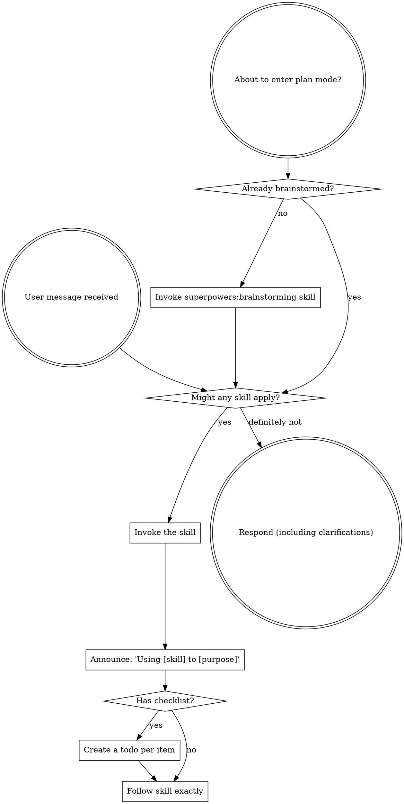

<SUBAGENT-STOP>
If you are a subagent with an assigned task, skip this skill.
</SUBAGENT-STOP>

<EXTREMELY-IMPORTANT>
IF A SKILL APPLIES TO YOUR TASK, YOU MUST USE IT.

This is mandatory.
</EXTREMELY-IMPORTANT>

## Instruction Priority

Apply instructions in this sequence, starting with the most important:

1. **User's explicit instructions** (CLAUDE.md, GEMINI.md, AGENTS.md, and what the user tells you directly)
2. **coderails skills** — override default system behavior when the instructions differ
3. **Default system prompt**

If CLAUDE.md, GEMINI.md, or AGENTS.md says "don't use TDD" and a skill says "always use TDD," follow the user's instructions. The user is in control.

## How to Access Skills

**Use your platform's skill-loading mechanism.** Do not read skill files manually with file tools.

**In Claude Code:** Use the `Skill` tool. When you invoke a skill, this tool gives you the instructions. Follow them directly.

**In Codex:** Codex activates skills. Follow the instructions it gives you when a skill activates.

**In Copilot CLI:** Use the `skill` tool. Skills are auto-discovered from installed plugins.

**In Gemini CLI:** Skills activate through the `activate_skill` tool. Gemini loads skill metadata at session start and activates the full content on demand.

**In other environments:** Check your platform's documentation for how to activate skills.

## Platform Adaptation

Skills speak in steps ("dispatch a subagent", "create a todo", "read a file") in terms that apply to multiple runtimes. For per-platform tool equivalents and instructions-file conventions, see [claude-code-tools.md](references/claude-code-tools.md), [codex-tools.md](references/codex-tools.md), [copilot-tools.md](references/copilot-tools.md), [gemini-tools.md](references/gemini-tools.md), [pi-tools.md](references/pi-tools.md), and [antigravity-tools.md](references/antigravity-tools.md). Gemini CLI users get the tool mapping loaded automatically through GEMINI.md.

# Using Skills

## The Rule

**Before you answer or do work, invoke applicable skills and skills the user names.** If an invoked skill does not apply, you can stop using it.

## Red Flags

If you have one of these thoughts, stop and check for applicable skills:

| Thought | Reality |
|---------|---------|
| "This is just a simple question" | Questions are tasks. Check for skills. |
| "I need more context first" | Skill check comes BEFORE clarifying questions. |
| "Let me explore the codebase first" | Skills tell you HOW to explore. Check first. |
| "I can check git/files quickly" | Files do not contain the conversation context. Check for skills. |
| "Let me gather information first" | Skills tell you HOW to collect information. |
| "This doesn't need a formal skill" | If a skill exists, use it. |
| "I remember this skill" | Skills evolve. Read current version. |
| "This doesn't count as a task" | Step = task. Check for skills. |
| "The skill is overkill" | Simple things become complex. Use it. |
| "I'll just do this one thing first" | Check BEFORE doing anything. |
| "This feels productive" | Undisciplined step wastes time. Skills prevent this. |
| "I know what that means" | Knowing the concept ≠ using the skill. Invoke it. |

## Skill Priority

When multiple skills could apply, use this sequence:

1. **Procedure skills first** (superpowers:brainstorming, superpowers:systematic-debugging). These skills tell you how to do the work.
2. **Implementation skills second** (frontend-design, mcp-builder) - these guide execution

"Let's build X" → superpowers:brainstorming first, then implementation skills.
"Fix this bug" → superpowers:systematic-debugging first, then domain-specific skills.

## Skill Types

**Rigid** (superpowers:test-driven-development, superpowers:systematic-debugging): Follow all the instructions as written.

**Flexible** (patterns): Adapt principles to context.

The skill itself tells you which.

## User Instructions

Instructions say WHAT, not HOW. "Add X" or "Fix Y" does not mean skip workflows.
